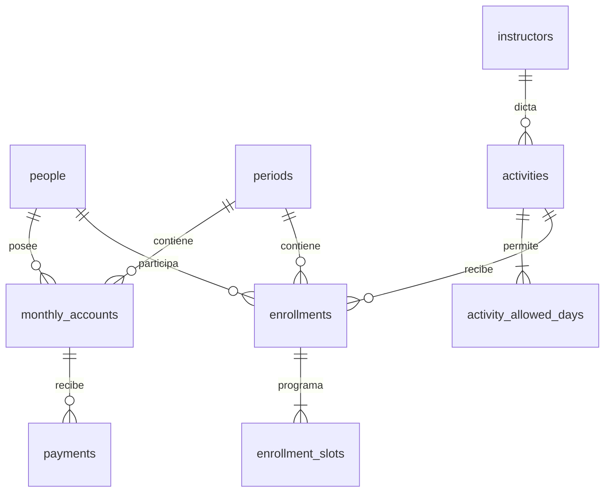

# Modelo y API

Contacto de emergencia opcional 1:1 embebido en `people`; no requiere tabla adicional. `advertising_investments` es independiente; se filtra por año/mes de su fecha. No depende de alumnos ni carteras.

Restricciones: persona/período/actividad única, persona/período de cuenta única, año/mes único, slot exacto único por inscripción, claves foráneas, montos no negativos y pagos positivos. Cancelar inscripción elimina sus slots pero conserva cuenta/pagos. Archivar persona conserva todas sus relaciones. Configuraciones se desactivan; no se borran.

| Endpoint            | Operaciones                                                       |
| ------------------- | ----------------------------------------------------------------- |
| /api/health         | GET, prueba conexión DB                                           |
| /api/people         | GET q/page/archived, POST                                         |
| /api/people/:id     | GET ficha+historia, PUT reemplazo validado, DELETE archivo lógico |
| /api/periods        | GET, POST año/mes; PUT/DELETE /:id solo vacío; PATCH /:id/status cierre/reapertura |
| /api/instructors    | GET, POST; PUT /:id                                               |
| /api/activities     | GET, POST; PUT /:id con days                                      |
| /api/enrollments    | GET period_id/person_id, POST; PUT/DELETE /:id                    |
| /api/accounts       | GET period_id/person_id, PUT person_id/period_id/amount_due       |
| /api/payments       | GET period_id, POST; PUT/DELETE /:id                              |
| /api/dashboard      | GET period_id                                                     |
| /api/advertising    | GET period_id, POST; PUT/DELETE /:id                              |
| /api/import/preview | POST multipart file, sheet, headerRow, mapping JSON opcional      |
| /api/import/commit  | POST rows con person/action/reviewed/target_id                    |
| /api/people/matches | POST identificadores para aviso anticipado de duplicados         |
| /api/forms-import/preview | POST multipart file, period_id, mapping opcional; sin escritura |
| /api/forms-import/commit | POST lote revisado, request_id, period_id, confirmed; atómico e idempotente |
| /api/auth/session | GET estado de configuración/sesión |
| /api/auth/login | POST contraseña; sesión HttpOnly y limitación de intentos |
| /api/auth/logout | POST revoca sesión y retira cookie |

Todas las rutas administrativas, incluida health, requieren sesión. Errores castellanos JSON: 401 sesión inválida, 422 validación, 409 duplicado/conflicto/período cerrado, 404 ausencia, 403 origen inválido, 413 tamaño, 429 límite, 503 autenticación sin configurar, 500 error interno sin stack. Método de pago `cash` deriva Jesica, `transfer` deriva Hernán; la cartera no se almacena duplicada.

Migraciones adicionales: 002 agrega activities.mode (group/individual); 003 crea import_receipts para reintentos; 004 crea admin_sessions con expiración. No almacenan contraseña plaintext ni CSV original. Reglas de superposición y cierre se aplican en transacciones backend; ver V1.md.

Las actualizaciones son reemplazos de formularios completos. La interfaz bloquea doble envío mientras hay una operación pendiente. No se implementa historial de autores ni sincronización colaborativa de formularios abiertos: la última edición guardada prevalece. Coordinar cambios simultáneos sobre una misma persona entre los dos administradores.
