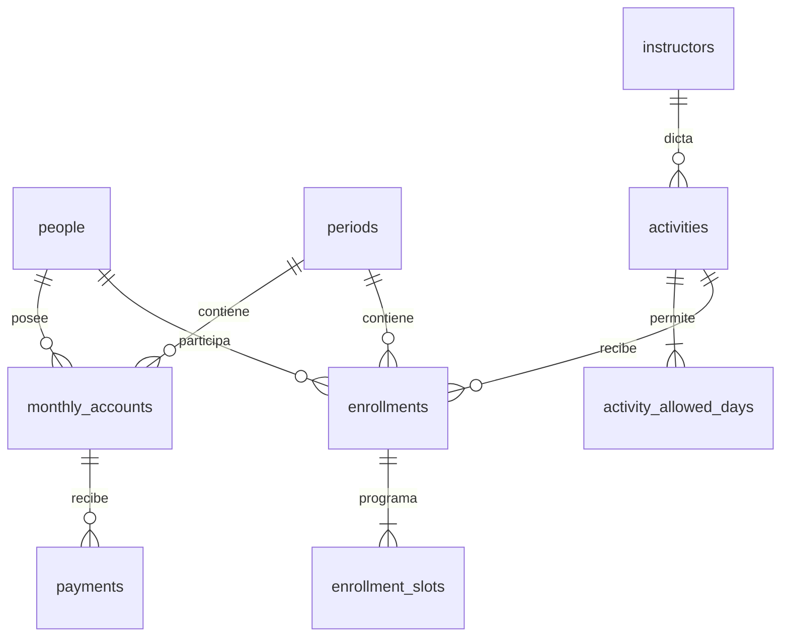

# Modelo y API

Contacto de emergencia opcional 1:1 embebido en `people`; no requiere tabla adicional. `advertising_investments` es independiente; se filtra por año/mes de su fecha. No depende de alumnos ni carteras.

Restricciones: persona/período/actividad única, persona/período de cuenta única, año/mes único, slot exacto único por inscripción, claves foráneas, montos no negativos y pagos positivos. Cancelar inscripción elimina sus slots pero conserva cuenta/pagos. Archivar persona conserva todas sus relaciones. Configuraciones se desactivan; no se borran.

| Endpoint            | Operaciones                                                       |
| ------------------- | ----------------------------------------------------------------- |
| /api/health         | GET, prueba conexión DB                                           |
| /api/people         | GET q/page/archived, POST                                         |
| /api/people/:id     | GET ficha+historia, PUT reemplazo validado, DELETE archivo lógico |
| /api/periods        | GET, POST año/mes                                                 |
| /api/instructors    | GET, POST; PUT /:id                                               |
| /api/activities     | GET, POST; PUT /:id con days                                      |
| /api/enrollments    | GET period_id/person_id, POST; PUT/DELETE /:id                    |
| /api/accounts       | GET period_id/person_id, PUT person_id/period_id/amount_due       |
| /api/payments       | GET period_id, POST; PUT/DELETE /:id                              |
| /api/dashboard      | GET period_id                                                     |
| /api/advertising    | GET period_id, POST; PUT/DELETE /:id                              |
| /api/import/preview | POST multipart file, sheet, headerRow, mapping JSON opcional      |
| /api/import/commit  | POST rows con person/action/reviewed/target_id                    |

Errores castellanos JSON: 422 validación, 409 duplicado, 404 ausencia, 403 origen inválido, 413 tamaño, 429 límite, 503 protección pendiente, 500 error interno sin stack. Método de pago `cash` deriva Jesica, `transfer` deriva Hernán; la cartera no se almacena duplicada.

Las actualizaciones son reemplazos de formularios completos. La interfaz bloquea doble envío mientras hay una operación pendiente. No se implementa historial de autores ni sincronización colaborativa de formularios abiertos: la última edición guardada prevalece. Coordinar cambios simultáneos sobre una misma persona entre los dos administradores.
